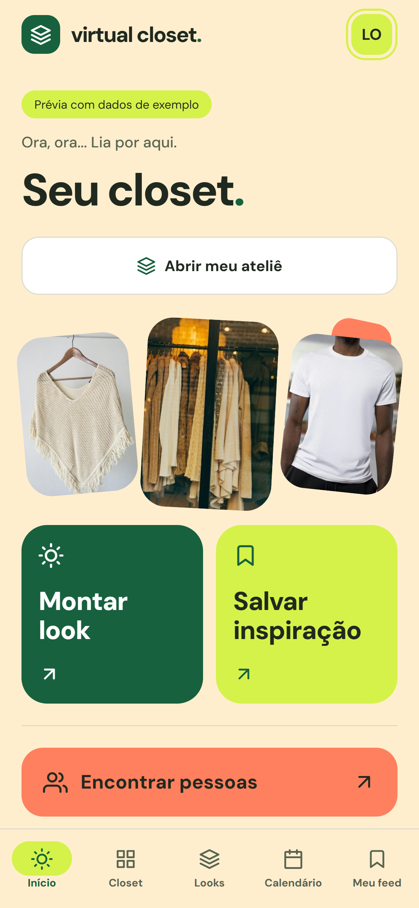
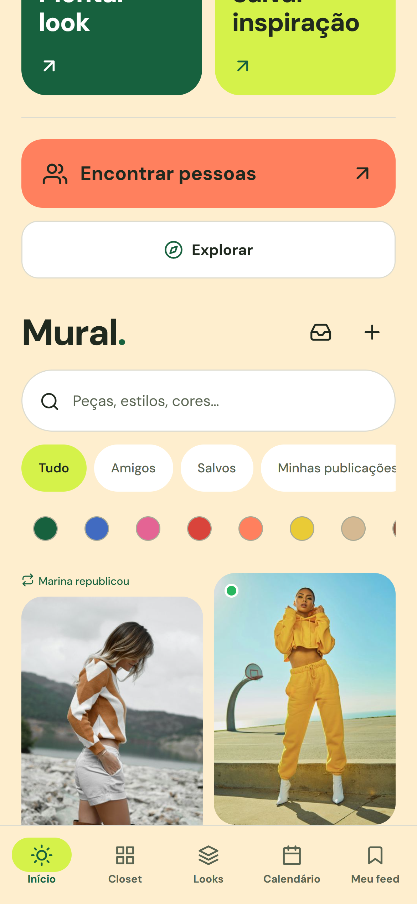
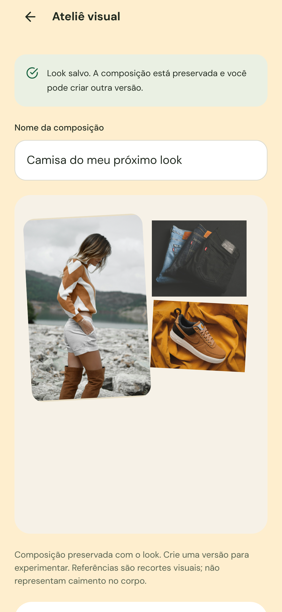

# Virtual Closet

> **Produto em desenvolvimento.** O Virtual Closet ainda está longe da versão que eu imagino para ele — e este repositório registra justamente a construção dessa visão, com protótipos funcionais, decisões de produto, testes e limites documentados com honestidade.

Estou criando o Virtual Closet para transformar o guarda-roupa em algo mais útil do que uma coleção de fotos. A ideia é ajudar pessoas a enxergar melhor o que já têm, experimentar combinações, guardar referências e tomar decisões de compra com mais intenção.

Não quero construir apenas um catálogo digital. Minha ambição é aproximar **acervo pessoal, inspiração, planejamento e expressão criativa** em uma experiência leve o bastante para fazer parte da rotina.

<table>
  <tr>
    <td width="33%"></td>
    <td width="33%"></td>
    <td width="33%"></td>
  </tr>
  <tr>
    <td align="center">O closet como ponto de partida</td>
    <td align="center">Descoberta visual no Mural</td>
    <td align="center">Da inspiração para uma combinação</td>
  </tr>
</table>

## Por que estou construindo isso

Grande parte dos aplicativos de moda começa pela compra. Eu quis começar por outra pergunta: **como usar melhor o que já está no armário?**

O Virtual Closet nasce de três problemas bem cotidianos:

- esquecer peças que já existem no guarda-roupa;
- ter referências salvas em vários lugares, sem conseguir conectá-las ao próprio estilo;
- comprar por impulso sem saber se a peça nova conversa com o restante do acervo.

Minha hipótese é que uma boa experiência de closet digital pode reduzir esse atrito sem transformar estilo pessoal em uma planilha. Por isso, o produto combina organização e dados com uma interface visual, descontraída e humana.

## O que já funciona

Hoje o projeto já possui fluxos funcionais e testáveis para:

- cadastro, sessão, perfil e preferências de privacidade;
- closet privado com fotos, categorias, cores, busca e arquivamento;
- criação de looks e calendário de uso;
- histórico, favoritos, custo por uso e sinais de peças pouco aproveitadas;
- Mural visual com filtros, publicações, curtidas e grade de alturas variadas;
- desejos de compra com foto, comparação e custo por uso hipotético;
- combinações entre uma inspiração do Mural e peças que a pessoa já possui;
- Ateliê visual para montar e salvar composições sem misturar referências com itens reais do closet;
- planejamento de viagens, lembretes locais e coleções;
- temas, redução de movimento, contraste e outras preferências de acessibilidade;
- conta de demonstração isolada, criada para apresentar o produto sem alterar a experiência de contas comuns.

As sugestões atuais são explicáveis e determinísticas: usam categoria, cor, disponibilidade e atributos confirmados pela própria pessoa. Quando falta informação, o app assume que ela é desconhecida em vez de inventar uma certeza.

## A visão maior

O fluxo que guia o desenvolvimento é simples de explicar, mas tecnicamente desafiador de executar bem:

```text
meu closet -> encontro uma referência -> salvo o que desejo
           -> combino com o que já tenho -> experimento possibilidades
           -> compro melhor (ou percebo que não preciso comprar)
```

No longo prazo, quero que o Virtual Closet consiga:

1. entender melhor proporções, texturas, ocasiões e preferências sem apagar a autonomia de quem usa;
2. sugerir combinações com motivos claros, e não com uma pontuação misteriosa;
3. avaliar quando uma foto de referência permite uma simulação confiável;
4. experimentar visualmente uma peça no corpo com privacidade, consentimento e qualidade real;
5. apoiar um guarda-roupa mais consciente por meio de uso, versatilidade e intenção de compra;
6. criar uma comunidade de inspiração feita por pessoas, com autoria e créditos preservados.

O provador realista é parte importante dessa visão, mas **ainda não está pronto**. O experimento local atual não entrega qualidade e tempo de resposta aceitáveis em hardware comum. Até resolver isso, o Ateliê é apresentado pelo que realmente é: uma composição visual, não uma simulação de caimento no corpo.

## Estado do produto

| Área | Estado atual |
| --- | --- |
| Experiência principal | Implementada em Expo/React Native, com prévia web |
| Closet, looks e calendário | Funcionais, com persistência privada via Supabase |
| Mural, desejos e Ateliê | Implementados e cobertos por testes locais |
| Acessibilidade e personalização | Implementadas; validação contínua em telas estreitas |
| Segurança do banco | RLS, funções transacionais e validação de propriedade nas migrations |
| Aplicativo nativo | Export iOS concluído; validação física ainda pendente |
| Backend hospedado | Algumas jornadas ainda precisam de validação autenticada ponta a ponta |
| Provador realista | Pesquisa experimental; ainda não utilizável |
| Publicação em loja | Fora do escopo atual |

Isso não é uma lista de promessas disfarçadas de funcionalidades. É o retrato do estágio atual do projeto.

## Decisões de engenharia

O aplicativo é construído com:

- **Expo + React Native + TypeScript** para compartilhar a base entre iOS, Android e web;
- **Expo Router** para navegação baseada em arquivos;
- **Supabase** para autenticação, PostgreSQL, Storage privado e Row Level Security;
- **Zustand** para sessão, rede e cache local isolado por usuário;
- **NativeWind** e componentes próprios para o sistema visual;
- **Vitest + PGlite** para regras de domínio e migrations reais em PostgreSQL local;
- **Playwright** para jornadas completas, estados de erro e layouts de 320 px.

Alguns princípios que adotei desde o início:

- fotos privadas ficam em bucket privado e o banco guarda caminhos, não URLs temporárias;
- desejos e referências não viram automaticamente peças possuídas;
- uma composição salva conta apenas as peças reais do closet;
- falhas de rede ambíguas não apagam uma imagem que pode ter sido persistida;
- fixtures de demonstração nunca são usadas como fallback silencioso no produto real;
- fontes e fotografias possuem origem e licença documentadas;
- funcionalidades experimentais são identificadas como experimentais.

## Arquitetura do repositório

```text
app/                    rotas e telas do Expo Router
src/components/         componentes compartilhados e interação
src/evolution/          regras de estilo, uso e planejamento
src/social/             Mural, publicações e conexões
src/wishes/             desejos, comparação e combinações
src/atelier/             composição visual e rascunhos
src/settings/           preferências, privacidade e acessibilidade
src/vision/             experimentos do provador realista
src/lib/                sessão, dados, cache e validação
supabase/migrations/    schema, RLS, RPCs e evolução do banco
tests/                  testes de domínio, banco e interface
docs/                   decisões, fontes e evidências visuais
```

## Qualidade e validação

Na última rodada completa registrada, o projeto passou por:

- **179 testes** de lógica e banco em **29 suítes**;
- **20 cenários distintos de navegador** para Ateliê, Mural, desejos, conta de demonstração, saudações e build conectado;
- TypeScript sem erros;
- lint dos arquivos alterados sem erros;
- export para iOS concluído.

Esses números representam validação local. Eles não substituem teste físico em aparelhos, monitoramento de produção ou um piloto com usuários reais — que são justamente os próximos degraus.

## Como executar

Pré-requisitos: Node.js compatível com o Expo SDK 57 e npm.

```powershell
git clone https://github.com/PedroCarvalho25/virtual-closet.git
cd virtual-closet
npm ci
Copy-Item .env.example .env.local
npm start
```

Preencha `.env.local` com a URL e a chave publicável de um projeto Supabase. A chave `service_role`, senhas do banco e chaves `sb_secret_...` nunca devem ser usadas no cliente.

Comandos principais:

```powershell
npm run typecheck
npm run lint
npm test
npm run test:ui
npm run web
```

As migrations estão em [`supabase/migrations`](supabase/migrations). Como o histórico do banco evoluiu junto com o protótipo, uma nova instalação deve aplicar os arquivos em ordem e conferir as dependências antes de conectar o app.

## Próximos passos

Minha prioridade agora é transformar um protótipo amplo em um produto cada vez mais confiável:

- validar as jornadas autenticadas em um ambiente hospedado limpo;
- testar iOS e Android em aparelhos físicos;
- medir desempenho com closets e murais maiores;
- ampliar testes de acessibilidade com pessoas reais;
- simplificar o onboarding sem esconder a profundidade do produto;
- conduzir um piloto pequeno e observar onde a experiência ainda exige explicação;
- continuar a pesquisa do provador realista sem sacrificar privacidade ou credibilidade.

## Sobre o processo

Este é um projeto autoral e ainda em movimento. Eu uso o repositório não só para guardar código, mas para tornar visíveis as escolhas por trás do produto: o que priorizei, o que descartei, o que aprendi testando e o que ainda não consegui resolver bem.

Prefiro deixar uma limitação explícita a apresentar uma demonstração enganosa. Para mim, a parte mais interessante do Virtual Closet não é a quantidade de telas; é construir uma ligação coerente entre estilo pessoal, tecnologia e decisões mais conscientes.

## Créditos

As imagens de demonstração não são apresentadas como conteúdo de usuários reais. Fontes, autores, licenças e hashes estão documentados em [`docs/PHOTO-SOURCES.md`](docs/PHOTO-SOURCES.md) e [`docs/PHOTO-PROVENANCE-20261015.json`](docs/PHOTO-PROVENANCE-20261015.json). As fontes locais mantêm suas licenças na pasta [`licenses`](licenses).

---

Desenvolvido por **Pedro Carvalho** · [GitHub](https://github.com/PedroCarvalho25)
